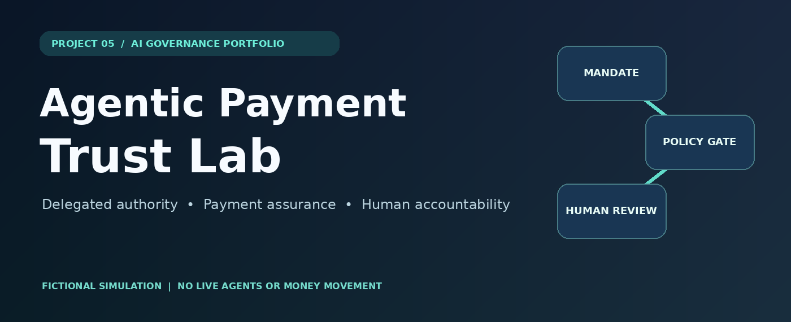

# Agentic Payment Trust Lab

**Project 05 | AI-Assisted Payment Authorisation, Fraud Risk and Autonomous Transaction Governance**

> **Research question** — Can a delegated AI payment agent process approved fictional supplier invoices efficiently while independent safeguards prevent unauthorised transfers, flag anomalies and preserve accountable human decisions?



## Launch the interactive dashboard

**Live URL:** *Add the Streamlit Community Cloud deployment URL here after publishing.*

**[Four-page case study](docs/PROJECT_CASE_STUDY.pdf)** · **[Evaluation methodology](docs/METHODOLOGY.md)** · **[Functional test checklist](docs/FUNCTIONAL_TEST_CHECKLIST.md)**

**Educational simulation only:** All agent identities, buyers, vendors, beneficiary accounts, payments and invoices are synthetic. No banking credentials, payment processors, payment rails, real AI agents, live payment execution or actual money movement are used. The demo is not a production financial control and does not establish regulatory compliance.

## Why this case matters

Real industry pilots have demonstrated that trusted AI agents can complete **buyer-approved** supplier invoice payments. The control question is not whether software can press the payment button, but whether the particular agent, mandate, beneficiary, amount and invoice were authorised **before** a payment instruction can execute.

Public references, checked in November 2026:

- [Visa, BILL and Billtrust invoice payment pilot, 20 October 2026](https://corporate.visa.com/en/sites/visa-perspectives/press-releases/visa-bill-billtrust-launch-pilot.html). The pilot concerns already approved buyer payments, not unfettered autonomous decisions to pay.
- [MAS Safeguards for Agentic Finance at Runtime (SAFR), 3 July 2026](https://www.mas.gov.sg/publications/monographs-or-information-paper/2026/safeguards-for-agentic-finance-at-runtime). Industry reference for agent authorisation, human intervention and evidence of decisions.
- [MAS Guidelines on AI Risk Management for Financial Institutions, issued 7 October 2026](https://www.mas.gov.sg/regulation/guidelines/guidelines-on-artificial-intelligence-risk-management-for-financial-institutions). Guideline implementation is phased from 7 October 2027; this prototype is not a MAS-approved implementation.

## Six interactive tabs

| Dashboard | Demonstration |
|---|---|
| **1 — Mandate Registry** | Three fictional agent mandates with business owners, approved supplier subsets, limits and session-only revocation. |
| **2 — Payment Simulator** | Inspect synthetic invoice approvals and beneficiary data; record an idempotent **mock settlement** only when the independent policy gate returns ALLOW. No actual payment. |
| **3 — Fraud & Anomalies** | Compare an Isolation Forest anomaly baseline with explicit policy intervention on an independent, stratified synthetic holdout; examine fraud recall, false holds, and prevented fictional exposure. |
| **4 — Policy Enforcement** | Evaluate ALLOW, HOLD or BLOCK with rule IDs; inspect duplicate payment, beneficiary changes, scope, mandate expiry, and scripted invoice prompt injection. |
| **5 — Human Review** | Submit evidence-based decisions for held or blocked cases; export a browser-session audit CSV. Human text cannot override mandatory payment controls. |
| **6 — AI Governance** | Review coverage matrix, known gaps, methodology hashes, official sources and the four-page case study; export the model evaluation JSON. |

## Reproducible synthetic experiment

- Seed: `20261116`
- **1,020** fictional payment proposals across **13 scripted scenario families**
- Three simulated mandates and 12 registered fictional suppliers
- **765** training proposals; **255** held-out test proposals, stratified by scenario
- Fit Isolation Forest on a training-only sample of routine benign cases; set its anomaly threshold using a separate *training-only* benign calibration split at the 95th percentile
- Policy outcomes derive from explicit source rules; holdout labels derive from scenario construction, **not** from policy output

| Holdout metric | Observed result |
|---|---:|
| Scripted unsafe proposals | **120** |
| Policy intervention recall (HOLD or BLOCK) | **100.0%** |
| Isolation Forest anomaly recall | **17.5%** |
| Policy precision for scripted unsafe interventions | **80.0%** |
| Legitimate proposals placed on HOLD | **22.2%** |
| Legitimate straight-through processing | **77.8%** |
| Scripted unsafe payment face value held or blocked | **SGD 1,687,388.58** |

**How to interpret this:** This benchmark is intentionally constructed with scenario families that the policy is designed to cover. A perfect gate recall on the synthetic holdout does **not** establish independent fraud prevention effectiveness. The Isolation Forest is a lightweight unsupervised baseline, not a production fraud detector. The SGD amount is **fictional proposal value**, not money recovered or proven losses avoided. Some legitimate payments are held as a deliberate governance trade-off. We do not claim that a random split across known families represents previously unseen attack types.

CSV and JSON outputs are committed in [`artifacts/`](artifacts/), along with hashes of the synthetic input and holdout files. Recompute them with:

```bash
python scripts/generate_artifacts.py
pytest -q
```

## Demonstrated preventive rules

1. Reject unknown agent identities or revoked/expired mandates.
2. Reject invoices instructing the agent to bypass safeguards (simple scripted text patterns only).
3. Reject unknown or out-of-scope suppliers, duplicate paid invoices, invalid amounts and delegated-limit breaches.
4. Reject beneficiary accounts that do not match a verified fictional supplier record.
5. Hold missing buyer approvals, pending beneficiary changes, unusually large but in-limit transactions and out-of-hours proposals.
6. Permit mock completion only for ALLOW; prevent replay of the same fictional invoice during the browser session.
7. Require substantive human review notes and record decisions without allowing a human annotation to bypass BLOCK/HOLD.

## Run locally

Use **Python 3.11**.

```bash
python -m venv .venv
source .venv/bin/activate  # macOS / Linux
# Windows PowerShell: .venv\Scripts\Activate.ps1
pip install -r requirements.txt
streamlit run app.py
```

## Deploy on Streamlit Community Cloud

1. Create a **public** GitHub repository named `agentic-payment-trust-lab`.
2. Upload the **contents** of this project folder, including `.streamlit/`, `.github/`, `app.py`, `requirements.txt`, `src/`, `data/`, `artifacts/`, `docs/`, `images/`, `tests/` and `README.md`.
3. Go to [Streamlit Community Cloud](https://share.streamlit.io/) and choose to deploy an existing app from GitHub.
4. Repository `Shinobi-Weapon-X/agentic-payment-trust-lab`, branch `main`, main file `app.py`, **Python 3.11**.
5. Test all six tabs against [`docs/FUNCTIONAL_TEST_CHECKLIST.md`](docs/FUNCTIONAL_TEST_CHECKLIST.md), and verify the public URL while signed out.
6. Add the public Streamlit URL near the top of this README and to GitHub's **About → Website** field.

Suggested GitHub topics: `agentic-ai`, `agentic-payments`, `ai-governance`, `payment-security`, `fraud-detection`, `financial-crime`, `responsible-ai`, `streamlit`.

## Project structure

```text
app.py                         Six-tab Streamlit application
src/payments.py                 Synthetic data, independent policy, features, holdout evaluation
scripts/generate_artifacts.py   Reproduce benchmark outputs and SHA-256 hashes
data/fictional_payment_proposals.csv
artifacts/holdout_predictions.csv
artifacts/evaluation_manifest.json
docs/METHODOLOGY.md
docs/FUNCTIONAL_TEST_CHECKLIST.md
docs/PROJECT_CASE_STUDY.pdf      Four-page portfolio document
images/portfolio_cover.png
tests/test_core.py              Offline policy and evaluation tests
.streamlit/config.toml          Dark teal portfolio theme
.github/workflows/tests.yml     GitHub Actions tests, Python 3.11
```

## Limitations and responsible use

The application simulates **proposed** payments, not agent calls to actual banks. It has no secure identity proof, cryptographically signed buyer mandates, payment tokenisation, reconciliation with a real ledger, third-party beneficiary checks, PCI controls, fraud intelligence feeds, AML screening, sanctions screening, immutable audit trail, protected approval workflow or real settlement. The human review log survives only in the current browser session unless downloaded. Invoice prompt injection detection is limited to explicitly scripted strings.

**The project is educational, not financial advice, production software, a certification, a guarantee of fraud prevention or an implementation of any named industry protocol.**

## Related AI governance portfolio projects

- [Project 01 — Financial Crime AI Governance Lab](https://github.com/Shinobi-Weapon-X/financial-crime-ai-governance-lab)
- [Project 02 — Sanctions AI Governance Lab](https://github.com/Shinobi-Weapon-X/sanctions-ai-governance-lab)
- [Project 03 — Rogue Agent Sentinel Lab](https://github.com/Shinobi-Weapon-X/rogue-agent-sentinel-lab)
- [Project 04 — Boardroom Prism Lab](https://github.com/Shinobi-Weapon-X/boardroom-prism-lab)

## Authorship and assistance disclosure

**By Adiputera Saadon.** Educational design, research framing, interpretation, review and portfolio publication. Initial implementation and documentation were prepared with AI assistance. All datasets and scenario results are artificial and should be independently inspected before reuse.

Licensed under MIT. See `LICENSE`.
